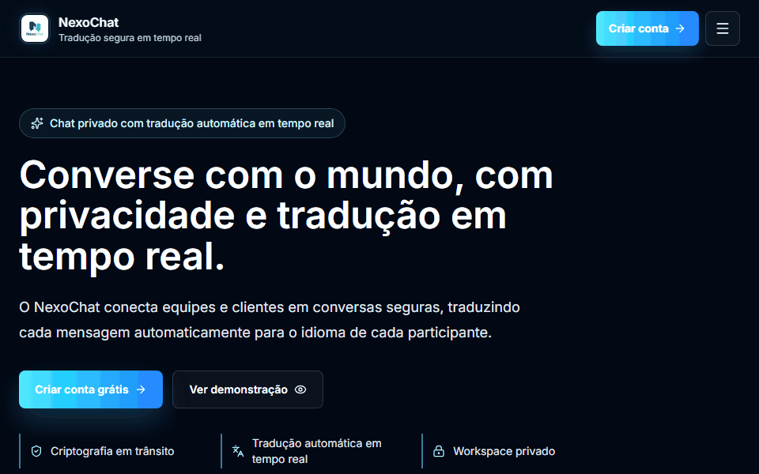

<picture>
  <source media="(max-width: 640px) and (prefers-color-scheme: dark)" srcset="./assets/hero-mobile-dark.svg">
  <source media="(max-width: 640px) and (prefers-color-scheme: light)" srcset="./assets/hero-mobile-light.svg">
  <source media="(prefers-color-scheme: dark)" srcset="./assets/hero-dark.svg">
  <source media="(prefers-color-scheme: light)" srcset="./assets/hero-light.svg">
  
</picture>

   
  

 

  
  
  

  <strong>Wolkendo Arias · Full-Stack Developer at Prime Secure</strong>

  I take products from interface and business logic to data, integrations, testing, and deployment.

  <strong>São Paulo, Brazil</strong> · Available for remote opportunities worldwide

  <a href="https://wolkendo.dev/en"><strong>Portfolio</strong></a>
  &nbsp;·&nbsp;
  <a href="https://www.linkedin.com/in/wolkendo-arias"><strong>LinkedIn</strong></a>
  &nbsp;·&nbsp;
  <a href="mailto:maestrowoldo97@gmail.com"><strong>Email</strong></a>

> **My approach:** Understand the problem. Design the experience. Build the system. Ship with confidence.

---

## Selected work

### NexoChat — Private conversations across languages

[NexoChat](https://nexochat.vercel.app/) is a responsive one-to-one messaging product that lets each participant write and receive messages in their preferred language. I designed and implemented the experience end to end, from product flows and real-time behavior to security, data, integrations, tests, and deployment.

<a href="https://nexochat.vercel.app/">
  <picture>
    <source media="(prefers-reduced-motion: reduce)" srcset="./assets/nexochat-preview.png">
    
  </picture>
</a>

  The demo shows a Portuguese interface with Portuguese-to-English translation. A static preview is used when reduced motion is preferred.

**Engineering highlights**

- Built real-time messaging, online presence, delivery states, and read states with Ably and backend-issued authentication.
- Added automatic language detection and translation through the DeepL API while preserving the original and translated message history.
- Secured the application with signed JWTs in HttpOnly cookies, CSRF protection, route guards, password hashing, and IP rate limiting.
- Modeled relational data with PostgreSQL and Prisma, with shared client/server validation through Zod.
- Integrated Cloudinary for media and Resend for transactional email, with secrets managed through Infisical.
- Established automated quality gates in GitHub Actions for tested preview and production deployments on Vercel.

**Stack:** Next.js 16, TypeScript, PostgreSQL, Prisma, Tailwind CSS, Ably, DeepL, Cloudinary, Resend

**[Open the live product →](https://nexochat.vercel.app/)** · Source code is private

---

### Personal Portfolio — Professional storytelling through product design

A multilingual portfolio that presents my experience, delivery process, and selected work through a responsive and accessible interface.

**Contribution:** Product direction, visual design, front-end development, content architecture, performance, and deployment 
**Stack:** Next.js, React, TypeScript, Tailwind CSS, Framer Motion

**[Explore the portfolio →](https://wolkendo.dev/en)**

---

### AppPonto — Attendance and workflow automation

An internal time-tracking solution developed during my internship at the São Paulo Court of Justice. It standardized attendance records, simplified operational follow-up, and connected reporting with automated communication.

**Contribution:** Requirements analysis, application development, business rules, integrations, UI design, validation, and documentation 
**Stack:** Power Apps, SharePoint, Power Automate, Power BI, Microsoft 365 
**Availability:** Public case documentation and screenshots; the original corporate application is not distributed

**[View the documented case →](https://github.com/maestrowoldo/Registro-de-Ponto)**

---

## Core Toolkit

### Product Interfaces

### APIs and Data

### Quality and Delivery

### Automation and Insights

---

---

## Experience

**Full-Stack Developer · Prime Secure** 
*November 2025 — Present* 
Building React and Next.js interfaces, Node.js APIs, relational data flows, validation, automated tests, and production delivery.

  <strong>Education:</strong> Bachelor's degree in Computer Science 
  <strong>Languages:</strong> Portuguese, Ingles, French, and Haitian Creole

---

## Education and languages

**Bachelor's degree in Computer Science** 
Universidade Cruzeiro do Sul · Completed December 2025

**Languages**

- French and Haitian Creole — Native
- Portuguese — Fluent
- English — Intermediate

---

<h2>Open to full-stack opportunities</h2>

  I welcome conversations with recruiters and engineering teams hiring for remote full-stack roles worldwide, especially where product thinking, reliable systems, and end-to-end ownership matter.

  <a href="mailto:maestrowoldo97@gmail.com"><strong>Start a conversation by email</strong></a>
  &nbsp;·&nbsp;
  <a href="https://www.linkedin.com/in/wolkendo-arias"><strong>Connect on LinkedIn</strong></a>

